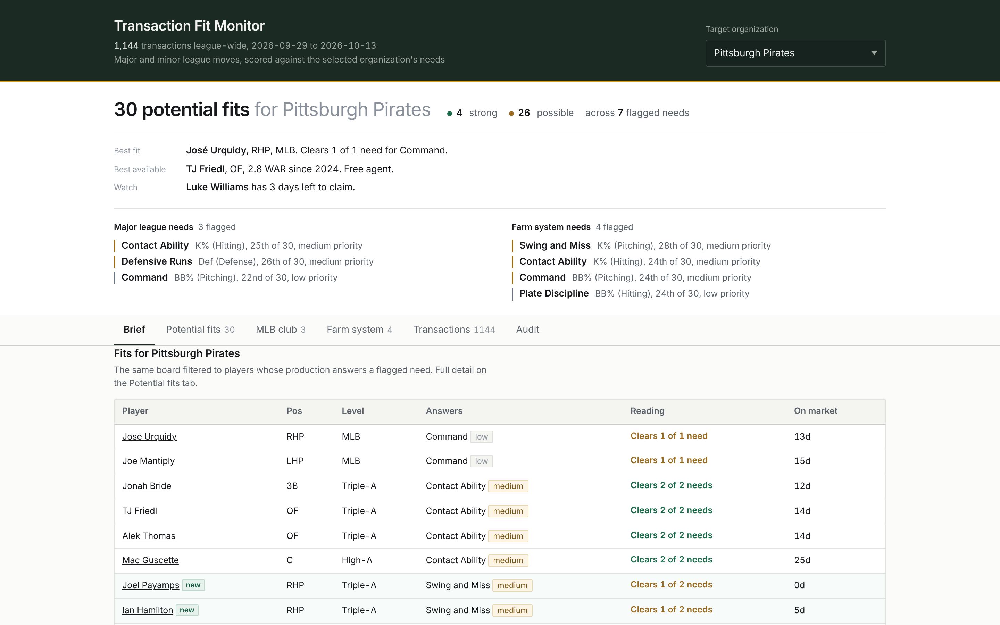

# Transaction Fit Monitor

**[Open the live dashboard →](https://drewrenteria.github.io/Transaction-Fit-Monitor/)**

[](https://drewrenteria.github.io/Transaction-Fit-Monitor/)

*Viewed as the Pittsburgh Pirates. Pick any of the thirty clubs from the
dropdown and the whole page re-scores instantly. Rebuilds itself daily.*

There is also a **[point-in-time rebuild of July 4, 2026](https://drewrenteria.github.io/Transaction-Fit-Monitor/snapshot-2026-07-04.html)**,
frozen mid-season so the claim clocks are live: transactions, FanGraphs rates
and the seven-day DFA window are all bounded to that date, nothing from after it
leaks in.

---

A single-file HTML dashboard that shows what is happening on the player market
across Major League Baseball and which of those players answer a specific
organization's weaknesses.

Built for people with ninety seconds. It opens on a brief: the best fit for
your club, who is new to the market this week, and the best players available
anywhere regardless of fit.


## What it does

- Pulls every transaction league-wide, major and minor, from the MLB Stats API
- Works out who is **actually gettable today** by walking each player's event
  sequence, so a player who was designated and then claimed drops off the board
- Runs a claim clock on designations, since that decision expires
- Flags each club's real weaknesses using rank **and** distance from league
  average, rather than "bottom half", which flags fifteen clubs on every metric
- Scores available players against those weaknesses, with the sample size
  caveats stated rather than buried
- Ships as one HTML file with no dependencies: email it, open it offline, print it

## Quick start

```bash
Rscript build.R                 # as of today
Rscript build.R 2026-07-04      # point-in-time rebuild of a past date
```

Output lands in `output/`. Open the HTML in any browser.

First run takes a few minutes and fills `cache/`. After that it is fast, and
changing `template.html` costs no network calls at all.

### Requirements

```r
install.packages(c("jsonlite", "dplyr", "purrr", "tibble", "httr2"))
```

## How it is put together

```
build.R                      run the chain end to end
R/00_config.R                constants and every tunable threshold
R/01_fetch_statsapi.R        transactions, clubs, bios, minor league rates
R/02_fetch_fangraphs.R       wRC+, FIP, xFIP, DRS, BsR, three-year lines
R/03_needs.R                 z-score need detection
R/04_availability.R          market status, claim clock, acquisition path
R/05_build_payload.R         assemble JSON, write the HTML
template.html                the page; reads the payload and scores fit in-browser
```

The page computes fit in the browser from one shipped dataset. That is why
switching organizations is instant rather than reloading: the data ships once
instead of being precomputed thirty times.

Thresholds all live in `R/00_config.R`. Change a cutoff there and rebuild.

## Where the numbers come from

| Layer | Source | Why |
|---|---|---|
| Transactions, rosters, positions | MLB Stats API | One call covers every club with MLBAM ids attached |
| Major league club needs | FanGraphs | wRC+, FIP, xFIP, DRS and BsR are park and league adjusted |
| Major league player lines | FanGraphs | Joined on MLBAM id, so no name matching |
| Farm needs and minor league lines | MLB Stats API | FanGraphs has no public minor league leaderboard on this path |

That last row is the weakest link and the page says so. Minor league rates carry
no park or level adjustment, so a .170 ISO in the complex league is treated the
same as a .170 ISO in Triple-A.

## Things that will bite you

**The Stats API code for Designated for Assignment is `DES`, not `DFA`.**
`DFA` is taken: it is the code for *Declared Free Agency*, the separate and far
rarer event where a player with the service time to do so elects free agency
after an outright. MLB's own `typeDesc` strings, counted over six weeks of the
2026 feed:

| `typeCode` | `typeDesc` | events |
|---|---|---|
| `DES` | Designated for Assignment | 123 |
| `DFA` | Declared Free Agency | 2 |

Mapping `DFA -> DFA` looks obviously correct, and quietly drops every real
designation while filling the board with free agents.

**Market-closing events arrive under more than one code.** A signing is `SFA`
when it is logged as a free agent signing and `SGN` when it is not; an
independent-league pickup is `ACQ` or `OBT`; a player coming back off a loan is
`RTN`. Any code left unmapped falls through as "Other" and can never close a
listing, which is how a player another club already signed would keep showing
as available. In the 2026 feed these four happen to close nobody who was on the
board — `SFA` already covers the affiliated path, and the rest are players
arriving from outside affiliated ball — but that is luck, not design. The Audit
tab counts unmapped types so the next unmapped code gets noticed before it
matters. What is left in "Other" now is suspensions, which genuinely belong in
neither bucket.

**`playerPool=All` on Stats API leaderboards.** The default returns only
qualified players: 46 major league pitchers instead of 868.

**FanGraphs keys fielding on nickname, batting and pitching on abbreviation,**
and its abbreviations differ from MLB's for seven clubs. The crosswalk is in
`00_config.R`; it warns loudly if a club fails to resolve.

**Sample size cuts both ways.** Only good numbers get flagged, so an ungated
small sample fills the board with players whose rates look strong precisely
because the sample is small. Rates are credited in tiers by where they
stabilize, and red flags are deliberately not gated the same way: missing a
decent player costs less than surfacing a bad one.

## Honest limitations

- **The labels are not validated.** A backtest over the 2026 season, grading
  every player who hit the market using only his prior-season line, found no
  significant relationship between the labels and whether anyone picked him up,
  on any outcome including waiver claims. The labels therefore describe what
  was computed ("clears 2 of 3 needs") rather than grade confidence
  ("strong match"). `python/backtest.py` reproduces this.
- That backtest tested whether a player is good in general, not whether he fits
  one club's specific hole, which is the narrower thing this tool claims.
  Testing that needs point-in-time club needs for each past date.
- The farm side is unadjusted for park and level.
- No write-back. Nobody can mark a player reviewed or dismissed, and nothing is
  logged automatically between runs. The Audit tab exports the current flag list
  as CSV so a forward record can be kept by hand.

## Data and licensing

Public data only: the MLB Stats API and FanGraphs leaderboards. No proprietary
or club-internal data is used, stored or committed, which is what makes this
shareable. **If you extend it with internal data, that stops being true** — move
the repo private and strip the cache before committing anything.

Not affiliated with or endorsed by MLB or FanGraphs.
